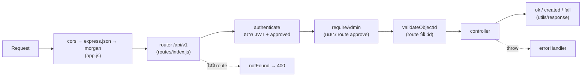
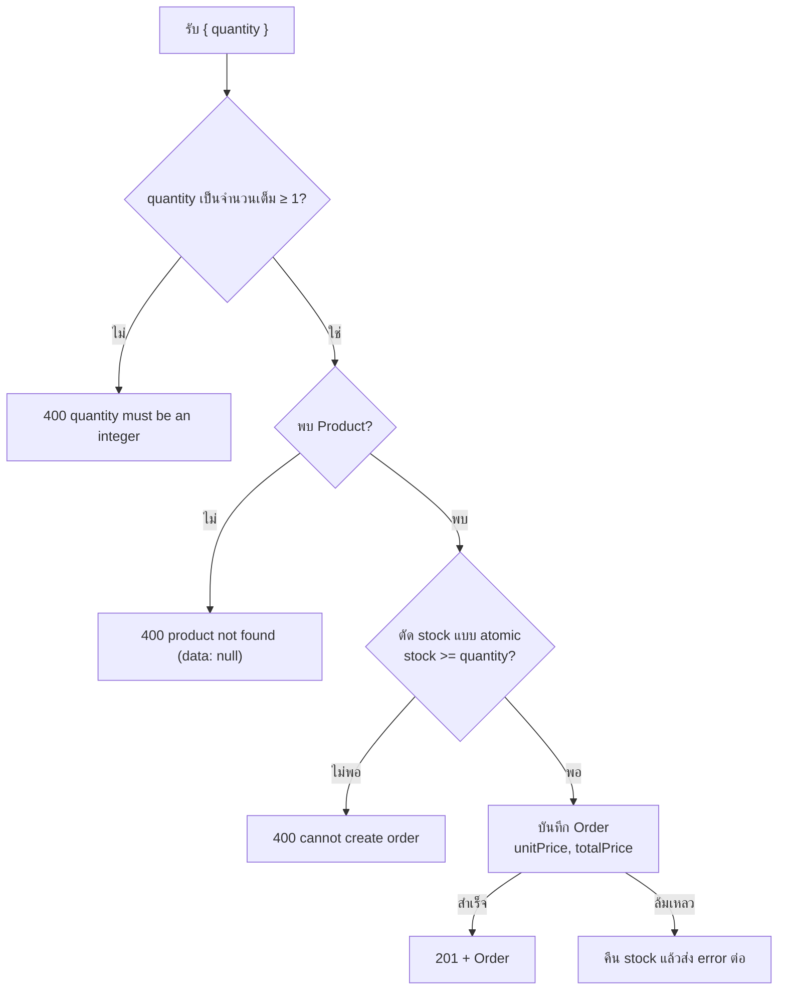

# Shop API (Express.js + MongoDB + Mongoose)

ระบบผู้ใช้ ↔ ร้านค้า ตาม flowchart: สมัครสมาชิก → รอ Approve → เข้าสู่ระบบ → จัดการ Product / Order (ตรวจ stock ก่อนบันทึก Order)

## สิ่งที่ต้องมี

- Node.js
- MongoDB ที่รันอยู่ (ค่าเริ่มต้น `localhost:27017`) — connection string ยังไม่รองรับ username/password ของ MongoDB

## ติดตั้งและรัน

```bash
npm install
cp .env.example .env          # แก้ DB_Host / DB_Port / DB_Name / JWT_SECRET ตามเครื่อง (Windows cmd ใช้ copy .env.example .env)
npm run dev                   # หรือ npm start
```

Base URL: `http://localhost:3000/api/v1`

ข้อมูลทั้งหมดมาจากการใช้งานผ่าน API / หน้าบ้าน ไม่มีสคริปต์ใส่ข้อมูลเริ่มต้น **ผู้ใช้คนแรกที่สมัครจะเป็น admin และ Approve แล้วโดยอัตโนมัติ** เพื่อใช้ Approve คนถัดไป

## Environment variables

| ตัวแปร | ค่าเริ่มต้น | คำอธิบาย |
|---|---|---|
| `PORT` | `3000` | พอร์ตของ server |
| `DB_Host` | `localhost` | host ของ MongoDB |
| `DB_Port` | `27017` | port ของ MongoDB |
| `DB_Name` | `WorkShop` | ชื่อ database |
| `JWT_SECRET` | - | **ต้องตั้งค่า** ไม่งั้น server ไม่ยอมรัน |
| `JWT_EXPIRES_IN` | `1d` | อายุของ token |

## โครงสร้าง

```
src/
├── app.js / server.js
├── config/db.js
├── models/            User, Product, Order
├── controllers/       auth, product, order
├── routes/index.js
├── middlewares/       auth (JWT + approved), validateObjectId, errorHandler
├── utils/             response, asyncHandler
```

## Flow การทำงาน

### 1. Flow ของผู้ใช้ (สมัคร → Approve → ใช้งาน)


1. ผู้ใช้สมัครผ่าน `POST /register` → ระบบสร้าง User ที่ `approved = false` และ role เป็น `user` ยกเว้นคนแรกของระบบที่จะได้ role `admin` และ `approved = true`
2. admin (คนแรกที่สมัคร) login แล้วเรียก `PUT /users/:id/approve` เพื่อ Approve
3. ผู้ใช้ login ด้วย `POST /login` → ได้ JWT (อายุตาม `JWT_EXPIRES_IN`) ถ้ายังไม่ Approve จะได้ 401
4. ใช้ token ใน header `Authorization: Bearer <token>` เพื่อจัดการ Product / Order

### 2. เส้นทางของ request ภายใน server



| ขั้น | ไฟล์ | ทำอะไร | ถ้าไม่ผ่าน |
|---|---|---|---|
| 1 | `app.js` | เปิด CORS, แปลง JSON body, log request | JSON พัง → 400 `invalid JSON body` |
| 2 | `routes/index.js` | `/register`, `/login` ผ่านได้เลย ส่วน route อื่นต้องผ่าน `authenticate` | ไม่มี route → 400 `route not found` |
| 3 | `middlewares/auth.js` → `authenticate` | ตรวจ `Bearer` token, verify JWT, หา User, เช็ค `approved` แล้วใส่ `req.user` | 401 |
| 4 | `middlewares/auth.js` → `requireAdmin` | เช็ค `role === 'admin'` (ใช้กับ `/users`, `/users/:id/approve` และการเพิ่ม/แก้ไข/ลบ Product) | 401 `forbidden: admin only` |
| 5 | `middlewares/validateObjectId.js` | เช็คว่า `:id` เป็น ObjectId ที่ถูกรูปแบบ | 400 `data: null` |
| 6 | `controllers/*` | ทำงานกับ MongoDB ผ่าน Mongoose แล้วตอบด้วย `utils/response` | 400 ตามกรณี |
| 7 | `middlewares/errorHandler.js` | จับ error ที่ throw ออกมา (ผ่าน `asyncHandler`) | Validation / duplicate → 400, อื่นๆ → 500 |

### 3. Flow การเพิ่ม Order (`POST /products/:id/orders`)



1. ตรวจ `quantity` ต้องเป็นจำนวนเต็มตั้งแต่ 1 ขึ้นไป
2. หา Product จาก `:id` ไม่พบ → 400
3. ตัด stock ด้วย `findOneAndUpdate({ stock: { $gte: quantity } }, { $inc: { stock: -quantity } })` ในคำสั่งเดียว ถ้า stock ไม่พอจะไม่มีการอัปเดต → 400
4. สร้าง Order โดยบันทึก `unitPrice` และ `totalPrice = price × quantity` ณ เวลาสั่ง
5. ถ้าบันทึก Order ไม่สำเร็จ จะคืน stock กลับให้ Product

### 4. ลำดับการลองใช้งาน

1. `npm run dev` แล้ว `POST /register` สมัครคนแรก → ได้เป็น admin (ถ้าระบบมีผู้ใช้อยู่แล้วให้ใช้บัญชี admin เดิม)
2. `POST /register` สมัคร user ใหม่ → จด `_id` จาก response
3. `POST /login` ด้วย admin → ได้ token ของ admin
4. `PUT /users/<_id>/approve` ด้วย token ของ admin
5. `POST /login` ด้วย user ใหม่ → ได้ token ของ user
6. `POST /products` เพิ่มสินค้าด้วย token ของ admin → จด `_id` ของสินค้า
7. `POST /products/<productId>/orders` กับ `{ "quantity": 1 }` ด้วย token ของ user → stock ลดลง
8. `GET /orders` หรือ `GET /products/<productId>/orders` ดู Order ที่สร้าง (user เห็นเฉพาะของตัวเอง, admin เห็นทั้งหมด)

## Response format

ทุก endpoint ตอบกลับรูปแบบเดียวกัน

```json
{ "status": 200, "message": "success", "data": [] }
```

| กรณี | data | status |
|---|---|---|
| ไม่มีหลายรายการ | `[]` | 200 |
| มีหลายรายการ | `[{...}, {...}]` | 200 |
| ไม่มีรายการเดียว | `null` | 400 |
| มีรายการเดียว | `{...}` | 200 |
| บันทึกสำเร็จ | `{...}` | 201 |

สถานะ status: 200 สำเร็จ · 201 สร้างสำเร็จ · 400 ไม่สำเร็จ · 401 ไม่มีสิทธิ์ · 500 ไม่ทราบสาเหตุ

กรณี error อื่นๆ

- Validation error → 400 และ `data` เป็น array ของข้อความ error เช่น `{ "status": 400, "message": "validation error", "data": ["..."] }`
- เรียก route ที่ไม่มีอยู่ → 400 `route not found`
- ไม่ส่ง token / token หมดอายุ / ยังไม่ Approve / ไม่ใช่ admin → 401 (ใช้ 401 ตาม flowchart ไม่ใช้ 403)

## Endpoints

| Method | Path | Auth | คำอธิบาย |
|---|---|---|---|
| POST | `/register` | - | สมัครสมาชิก (approved = false) |
| POST | `/login` | - | เข้าสู่ระบบ → ได้ JWT (ไม่มีบัญชี / ยังไม่ Approve → 401) |
| GET | `/users` | admin | แสดงรายชื่อผู้ใช้ทั้งหมด (ใหม่สุดก่อน) |
| PUT | `/users/:id/approve` | admin | Approve ผู้ใช้ |
| GET | `/products` | user | แสดงรายการ Product ทั้งหมด |
| GET | `/products/:id` | user | ดูรายการ Product 1 รายการ |
| POST | `/products` | admin | เพิ่มรายการ Product |
| PUT | `/products/:id` | admin | แก้ไขรายการ Product |
| DELETE | `/products/:id` | admin | ลบรายการ Product |
| GET | `/orders` | user | แสดง Order ทุกรายการ (user เห็นเฉพาะของตัวเอง, admin เห็นทั้งหมด) |
| GET | `/products/:id/orders` | user | แสดง Order ทั้งหมดของ Product (user เห็นเฉพาะของตัวเอง, admin เห็นทั้งหมด) |
| POST | `/products/:id/orders` | user | เพิ่ม Order ใน Product (quantity ต้องไม่เกิน stock) |

Route ที่ต้อง auth ให้ส่ง header `Authorization: Bearer <token>` และผู้ใช้ต้องได้รับการ Approve แล้ว

คอลัมน์ Auth: `user` = ผู้ใช้ที่ login แล้วทุกคน (รวม admin), `admin` = เฉพาะ role admin (ไม่ใช่ admin จะได้ 401 `forbidden: admin only`)

## ตัวอย่าง body

```jsonc
// POST /register
{ "email": "bob@example.com", "password": "123456", "firstName": "Bob", "lastName": "Lee" }

// POST /login
{ "email": "bob@example.com", "password": "123456" }
// → 200 { "status": 200, "message": "success", "data": { "token": "<JWT>", "user": { ... } } }

// POST /products, PUT /products/:id
{ "name": "Pen", "description": "Blue pen", "price": 10, "stock": 5 }

// POST /products/:id/orders
{ "quantity": 3 }
```

Validation

- `email` ต้องถูกรูปแบบและห้ามซ้ำ (เก็บเป็นตัวพิมพ์เล็ก), `password` ยาวอย่างน้อย 6 ตัวอักษร
- Product ต้องมี `name` และ `price`, ส่วน `price` และ `stock` ต้องไม่ติดลบ และ `stock` ต้องเป็นจำนวนเต็ม
- `quantity` ต้องเป็นจำนวนเต็มตั้งแต่ 1 ขึ้นไป

> เติม stock ใช้ `PUT /products/:id` กับ `{ "stock": 10 }` (ตั้งค่า stock ใหม่)

## Business rules

- เพิ่ม Order: ตัด stock แบบ atomic (`findOneAndUpdate` กับเงื่อนไข `stock >= quantity`) กัน order ที่ยิงพร้อมกันทำให้ stock ติดลบ ถ้าเกิน stock ตอบ 400 "cannot create order"
- Order เก็บ `unitPrice` / `totalPrice` ณ เวลาสั่ง ราคา Product เปลี่ยนทีหลังไม่กระทบ Order เดิม
- `/register` ไม่รับ `role` / `approved` จาก body กันการตั้งตัวเองเป็น admin (admin มีได้จากการเป็นผู้สมัครคนแรกของระบบเท่านั้น)
- สิทธิ์ตาม role: user ดูสินค้า สั่งซื้อ และดู Order ของตัวเองได้ ส่วน admin จัดการสินค้า ดู Order ของทุกคน และดู/Approve ผู้ใช้ได้
- id ผิดรูปแบบหรือไม่พบ → `data: null`, status 400 ตาม flowchart
- ลบ Product แล้ว Order เดิมของสินค้านั้นยังอยู่ แต่ field `product` ใน Order จะเป็น `null` ตอนดึงข้อมูล
