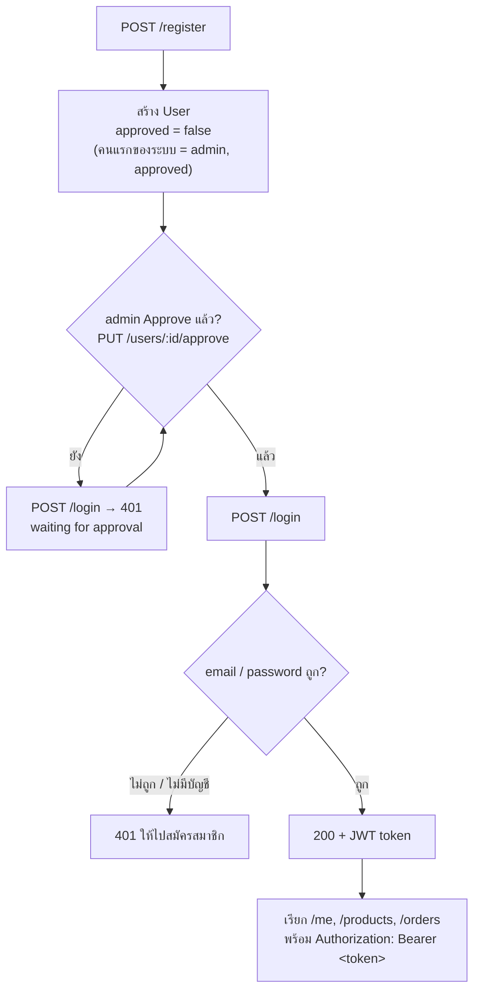
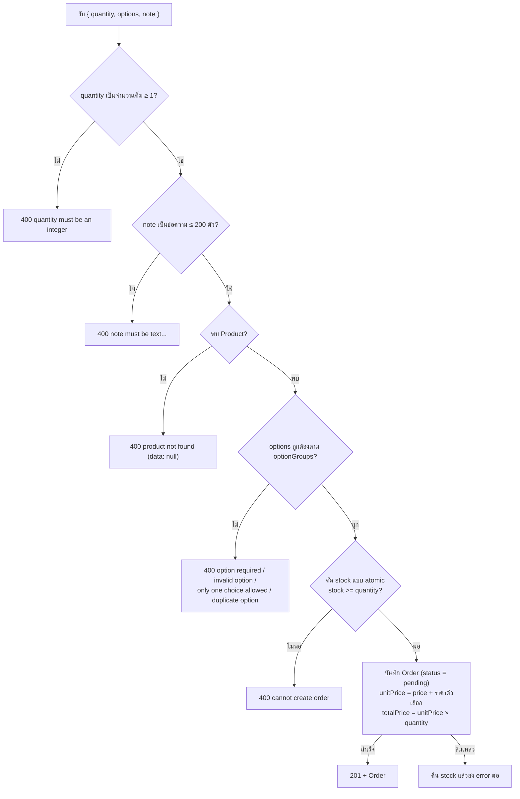
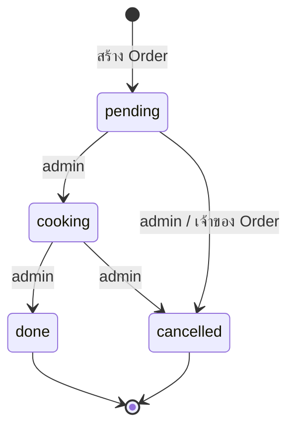

# Shop API (Express.js + MongoDB + Mongoose)

ระบบผู้ใช้ ↔ ร้านอาหาร ตาม flowchart: สมัครสมาชิก → รอ Approve → เข้าสู่ระบบ → จัดการเมนู (Product) / สั่งอาหาร (Order) พร้อมตัวเลือก (เช่น เนื้อสัตว์ ขนาด ความเผ็ด) → ร้านเปลี่ยนสถานะ Order (pending → cooking → done) หรือยกเลิก

## สิ่งที่ต้องมี

- Node.js
- MongoDB ที่รันอยู่ (ค่าเริ่มต้น `localhost:27017`) — connection string ยังไม่รองรับ username/password ของ MongoDB

## ติดตั้งและรัน

```bash
npm install
cp .env.example .env          # แก้ DB_Host / DB_Port / DB_Name / JWT_SECRET ตามเครื่อง (Windows cmd ใช้ copy .env.example .env)
npm run seed                  # (ไม่บังคับ) ใส่เมนูตัวอย่าง
npm run dev                   # หรือ npm start
```

Base URL: `http://localhost:3000/api/v1`

**ผู้ใช้คนแรกที่สมัครจะเป็น admin และ Approve แล้วโดยอัตโนมัติ** เพื่อใช้ Approve คนถัดไป (สคริปต์ seed ใส่เฉพาะเมนู ไม่สร้างผู้ใช้)

### ใส่เมนูตัวอย่าง (seed)

| คำสั่ง | ทำอะไร |
|---|---|
| `npm run seed` | เพิ่ม/อัปเดตเมนูตัวอย่าง 18 รายการ (จับคู่ตาม `name`) — เมนูที่ชื่อตรงกันจะถูกเขียนทับราคา, stock และตัวเลือก ส่วนเมนูอื่นและ Order เดิมไม่ถูกแตะ |
| `npm run seed -- --reset` | **ลบ Product และ Order ทั้งหมดใน database** แล้วค่อยใส่เมนูตัวอย่างใหม่ |

> ⚠️ `--reset` ลบข้อมูลทันทีโดย**ไม่ถามยืนยัน** และกู้คืนไม่ได้ (Order ของลูกค้าทุกคนหายหมด) ใช้กับ database สำหรับทดสอบเท่านั้น และเช็ค `DB_Name` ใน `.env` ก่อนรันทุกครั้ง

### อัปเกรดจาก database เวอร์ชันเก่า (เคยใช้ `username`)

เวอร์ชันก่อนหน้าใช้ `username` เป็นตัวระบุผู้ใช้ ตอนนี้เปลี่ยนเป็น `email` แล้ว แต่ MongoDB **ไม่ลบ unique index `username_1` ให้เอง** ถ้าใช้ database เดิมต่อ ผู้ใช้คนแรกสมัครได้ แต่คนที่ 2 เป็นต้นไปจะได้ 400 `duplicate value: username` (เพราะ `username` เป็น `null` ซ้ำกัน)

แก้ได้ 2 ทาง

```js
// ทางที่ 1: ลบ index เดิม (รันใน mongosh บน database ที่ใช้อยู่ เช่น use WorkShop)
db.users.dropIndex('username_1')
```

ทางที่ 2: เริ่ม database ใหม่ (เปลี่ยน `DB_Name` ใน `.env` หรือ drop database เดิม) แล้วสมัคร admin ใหม่

## Environment variables

| ตัวแปร | ค่าเริ่มต้น | คำอธิบาย |
|---|---|---|
| `PORT` | `3000` | พอร์ตของ server |
| `DB_Host` | `localhost` | host ของ MongoDB |
| `DB_Port` | `27017` | port ของ MongoDB |
| `DB_Name` | `WorkShop` | ชื่อ database |
| `JWT_SECRET` | - | **ต้องตั้งค่า** ไม่งั้น server ไม่ยอมรัน |
| `JWT_EXPIRES_IN` | `1d` | อายุของ token |

## โครงสร้าง

```
src/
├── app.js / server.js
├── config/db.js
├── models/            User, Product (มี optionGroups), Order (มี options, note, status)
├── controllers/       auth (รวมโปรไฟล์ /me), product, order
├── routes/index.js
├── middlewares/       auth (JWT + approved), validateObjectId, errorHandler
├── utils/             response, asyncHandler
└── scripts/seedMenu.js   ใส่เมนูตัวอย่าง (npm run seed)
```

## Flow การทำงาน

### 1. Flow ของผู้ใช้ (สมัคร → Approve → ใช้งาน)



1. ผู้ใช้สมัครผ่าน `POST /register` → ระบบสร้าง User ที่ `approved = false` และ role เป็น `user` ยกเว้นคนแรกของระบบที่จะได้ role `admin` และ `approved = true`
2. admin (คนแรกที่สมัคร) login แล้วเรียก `PUT /users/:id/approve` เพื่อ Approve
3. ผู้ใช้ login ด้วย `POST /login` → ได้ JWT (อายุตาม `JWT_EXPIRES_IN`) ถ้ายังไม่ Approve จะได้ 401
4. ใช้ token ใน header `Authorization: Bearer <token>` เพื่อดู/แก้โปรไฟล์ และจัดการ Product / Order

### 2. เส้นทางของ request ภายใน server


| ขั้น | ไฟล์ | ทำอะไร | ถ้าไม่ผ่าน |
|---|---|---|---|
| 1 | `app.js` | เปิด CORS, แปลง JSON body, log request | JSON พัง → 400 `invalid JSON body` |
| 2 | `routes/index.js` | `/register`, `/login` ผ่านได้เลย ส่วน route อื่นต้องผ่าน `authenticate` | ไม่มี route → 400 `route not found` |
| 3 | `middlewares/auth.js` → `authenticate` | ตรวจ `Bearer` token, verify JWT, หา User, เช็ค `approved` แล้วใส่ `req.user` | 401 |
| 4 | `middlewares/auth.js` → `requireAdmin` | เช็ค `role === 'admin'` (ใช้กับ `/users`, `/users/:id/approve` และการเพิ่ม/แก้ไข/ลบ Product) | 401 `forbidden: admin only` |
| 5 | `middlewares/validateObjectId.js` | เช็คว่า `:id` เป็น ObjectId ที่ถูกรูปแบบ | 400 `data: null` |
| 6 | `controllers/*` | ทำงานกับ MongoDB ผ่าน Mongoose แล้วตอบด้วย `utils/response` | 400 ตามกรณี |
| 7 | `middlewares/errorHandler.js` | จับ error ที่ throw ออกมา (ผ่าน `asyncHandler`) | Validation / duplicate → 400, อื่นๆ → 500 |

### 3. Flow การเพิ่ม Order (`POST /products/:id/orders`)



1. ตรวจ `quantity` ต้องเป็นจำนวนเต็มตั้งแต่ 1 ขึ้นไป และ `note` (ไม่บังคับ) ต้องเป็นข้อความไม่เกิน 200 ตัวอักษร
2. หา Product จาก `:id` ไม่พบ → 400
3. ตรวจ `options` กับ `optionGroups` ของ Product
   - `options` ต้องเป็น array ของ `{ group, choice }` (ไม่ส่งได้ ถ้าเมนูไม่มีกลุ่มที่บังคับ)
   - กลุ่มที่ `isRequired: true` ต้องเลือก → ไม่เลือกได้ 400 `option required: <กลุ่ม>`
   - กลุ่มที่ `isMultiple: false` เลือกได้ 1 ตัวเลือก, `isMultiple: true` เลือกได้หลายตัวแต่ห้ามซ้ำ
   - ชื่อกลุ่ม/ตัวเลือกที่ไม่มีในเมนู → 400 `invalid option`
4. ตัด stock ด้วย `findOneAndUpdate({ stock: { $gte: quantity } }, { $inc: { stock: -quantity } })` ในคำสั่งเดียว ถ้า stock ไม่พอจะไม่มีการอัปเดต → 400
5. สร้าง Order สถานะ `pending` โดยบันทึก `productName`, `options` (พร้อมราคาของแต่ละตัวเลือก), `unitPrice = price + ราคาตัวเลือกรวม` และ `totalPrice = unitPrice × quantity` ณ เวลาสั่ง
6. ถ้าบันทึก Order ไม่สำเร็จ จะคืน stock กลับให้ Product

### 4. สถานะ Order (`PUT /orders/:id/status`)



| เปลี่ยนเป็น | เปลี่ยนได้จาก | ใครเปลี่ยนได้ | หมายเหตุ |
|---|---|---|---|
| `cooking` | `pending` | admin | |
| `done` | `cooking` | admin | |
| `cancelled` | `pending`, `cooking` | admin | **คืน stock** ตาม `quantity` ของ Order |
| `cancelled` | `pending` เท่านั้น | user (เฉพาะ Order ของตัวเอง) | **คืน stock** ตาม `quantity` ของ Order |

- `done` และ `cancelled` เป็นสถานะสุดท้าย เปลี่ยนต่อไม่ได้
- เปลี่ยนข้ามขั้น / ย้อนกลับ (เช่น `pending → done`, `done → cancelled`) → 400 `cannot change status from <เดิม> to <ใหม่>`
- `status` ไม่ใช่ `cooking` / `done` / `cancelled` → 400 `invalid status`
- user ขอเปลี่ยนเป็นสถานะอื่นที่ไม่ใช่ `cancelled` → 401 `forbidden: admin only`
- ไม่พบ Order หรือเป็น Order ของคนอื่น (กรณี user) → 400 `order not found` (`data: null`)

### 5. ลำดับการลองใช้งาน

1. `npm run seed` (ไม่บังคับ) แล้ว `npm run dev`
2. `POST /register` สมัครคนแรก → ได้เป็น admin (ถ้าระบบมีผู้ใช้อยู่แล้วให้ใช้บัญชี admin เดิม)
3. `POST /register` สมัคร user ใหม่ → จด `_id` จาก response
4. `POST /login` ด้วย admin → ได้ token ของ admin
5. `PUT /users/<_id>/approve` ด้วย token ของ admin
6. `POST /login` ด้วย user ใหม่ → ได้ token ของ user
7. `GET /me` ดูโปรไฟล์ / `PUT /me` แก้ชื่อ / `PUT /me/password` เปลี่ยนรหัสผ่าน
8. `POST /products` เพิ่มเมนูพร้อม `optionGroups` ด้วย token ของ admin (หรือใช้เมนูจาก seed) → จด `_id`
9. `POST /products/<productId>/orders` พร้อม `quantity` และ `options` ด้วย token ของ user → stock ลดลง, Order เป็น `pending`
10. admin เรียก `PUT /orders/<orderId>/status` เป็น `cooking` แล้ว `done` หรือ user ยกเลิก Order ที่ยัง `pending` ด้วย `cancelled` → stock คืน
11. `GET /orders` หรือ `GET /products/<productId>/orders` ดู Order (user เห็นเฉพาะของตัวเอง, admin เห็นทั้งหมด)

## Response format

ทุก endpoint ตอบกลับรูปแบบเดียวกัน

```json
{ "status": 200, "message": "success", "data": [] }
```

| กรณี | data | status |
|---|---|---|
| ไม่มีหลายรายการ | `[]` | 200 |
| มีหลายรายการ | `[{...}, {...}]` | 200 |
| ไม่มีรายการเดียว | `null` | 400 |
| มีรายการเดียว | `{...}` | 200 |
| บันทึกสำเร็จ | `{...}` | 201 |

สถานะ status: 200 สำเร็จ · 201 สร้างสำเร็จ · 400 ไม่สำเร็จ · 401 ไม่มีสิทธิ์ · 500 ไม่ทราบสาเหตุ

กรณี error อื่นๆ

- Validation error → 400 และ `data` เป็น array ของข้อความ error เช่น `{ "status": 400, "message": "validation error", "data": ["..."] }`
- เรียก route ที่ไม่มีอยู่ → 400 `route not found`
- ไม่ส่ง token / token หมดอายุ / ยังไม่ Approve / ไม่ใช่ admin → 401 (ใช้ 401 ตาม flowchart ไม่ใช้ 403)

## Endpoints

| Method | Path | Auth | คำอธิบาย |
|---|---|---|---|
| POST | `/register` | - | สมัครสมาชิก (approved = false) |
| POST | `/login` | - | เข้าสู่ระบบ → ได้ JWT (ไม่มีบัญชี / ยังไม่ Approve → 401) |
| GET | `/users` | admin | แสดงรายชื่อผู้ใช้ทั้งหมด (ใหม่สุดก่อน) |
| PUT | `/users/:id/approve` | admin | Approve ผู้ใช้ |
| GET | `/me` | user | ดูโปรไฟล์ของตัวเอง |
| PUT | `/me` | user | แก้ไข `firstName` / `lastName` ของตัวเอง |
| PUT | `/me/password` | user | เปลี่ยนรหัสผ่าน (ต้องส่งรหัสผ่านเดิม) |
| GET | `/products` | user | แสดงรายการ Product ทั้งหมด |
| GET | `/products/:id` | user | ดูรายการ Product 1 รายการ |
| POST | `/products` | admin | เพิ่มรายการ Product |
| PUT | `/products/:id` | admin | แก้ไขรายการ Product |
| DELETE | `/products/:id` | admin | ลบรายการ Product |
| GET | `/orders` | user | แสดง Order ทุกรายการ (user เห็นเฉพาะของตัวเอง, admin เห็นทั้งหมด) |
| GET | `/products/:id/orders` | user | แสดง Order ทั้งหมดของ Product (user เห็นเฉพาะของตัวเอง, admin เห็นทั้งหมด) |
| POST | `/products/:id/orders` | user | เพิ่ม Order ใน Product (ตรวจตัวเลือก และ quantity ต้องไม่เกิน stock) |
| PUT | `/orders/:id/status` | user / admin | เปลี่ยนสถานะ Order (admin: cooking / done / cancelled, user: cancelled เฉพาะ Order ตัวเองที่ยัง pending) |

Route ที่ต้อง auth ให้ส่ง header `Authorization: Bearer <token>` และผู้ใช้ต้องได้รับการ Approve แล้ว

คอลัมน์ Auth: `user` = ผู้ใช้ที่ login แล้วทุกคน (รวม admin), `admin` = เฉพาะ role admin (ไม่ใช่ admin จะได้ 401 `forbidden: admin only`)

## ตัวอย่าง body

```jsonc
// POST /register
{ "email": "bob@example.com", "password": "123456", "firstName": "Bob", "lastName": "Lee" }

// POST /login
{ "email": "bob@example.com", "password": "123456" }
// → 200 { "status": 200, "message": "success", "data": { "token": "<JWT>", "user": { ... } } }

// PUT /me
{ "firstName": "Bobby", "lastName": "Lee" }

// PUT /me/password
{ "currentPassword": "123456", "newPassword": "654321" }

// POST /products, PUT /products/:id
{
  "name": "ข้าวกะเพรา",
  "description": "กะเพราผัดไฟแรง ราดข้าวสวยร้อนๆ",
  "category": "จานเดียว",
  "imageUrl": "https://example.com/kaprao.jpg",
  "price": 50,
  "stock": 40,
  "optionGroups": [
    {
      "name": "เนื้อสัตว์", "isRequired": true, "isMultiple": false,
      "choices": [{ "name": "หมูสับ", "price": 0 }, { "name": "กุ้ง", "price": 15 }]
    },
    {
      "name": "เพิ่มเติม", "isRequired": false, "isMultiple": true,
      "choices": [{ "name": "ไข่ดาว", "price": 10 }, { "name": "ข้าวเพิ่ม", "price": 5 }]
    }
  ]
}

// POST /products/:id/orders
{
  "quantity": 2,
  "options": [
    { "group": "เนื้อสัตว์", "choice": "กุ้ง" },
    { "group": "เพิ่มเติม", "choice": "ไข่ดาว" }
  ],
  "note": "ไม่ใส่ผักชี"
}
// → unitPrice = 50 + 15 + 10 = 75, totalPrice = 150

// PUT /orders/:id/status
{ "status": "cooking" }   // หรือ "done", "cancelled"
```

Validation

- `email` ต้องถูกรูปแบบและห้ามซ้ำ (เก็บเป็นตัวพิมพ์เล็ก), `password` ยาวอย่างน้อย 6 ตัวอักษร
- `PUT /me`: ต้องส่งทั้ง `firstName` และ `lastName` เป็นข้อความไม่ว่าง ยาวไม่เกิน 50 ตัวอักษร (แก้ email / role ไม่ได้)
- `PUT /me/password`: `currentPassword` ต้องถูก, `newPassword` ยาวอย่างน้อย 6 ตัวอักษรและต้องไม่ซ้ำรหัสเดิม
- Product ต้องมี `name` และ `price`, ส่วน `price` และ `stock` ต้องไม่ติดลบ และ `stock` ต้องเป็นจำนวนเต็ม
- `category` ไม่ส่งจะเป็น `อื่นๆ`, `description` / `imageUrl` ไม่ส่งจะเป็น `""`
- `optionGroups`: ชื่อกลุ่มห้ามซ้ำ, แต่ละกลุ่มต้องมีอย่างน้อย 1 ตัวเลือก, ชื่อตัวเลือกในกลุ่มเดียวกันห้ามซ้ำ, `price` ของตัวเลือกต้องไม่ติดลบ (ไม่ส่งเป็น 0)
- `quantity` ต้องเป็นจำนวนเต็มตั้งแต่ 1 ขึ้นไป, `note` ไม่เกิน 200 ตัวอักษร

> เติม stock ใช้ `PUT /products/:id` กับ `{ "stock": 10 }` (ตั้งค่า stock ใหม่)
>
> `PUT /products/:id` ที่ส่ง `optionGroups` จะ**แทนที่ตัวเลือกทั้งหมด**ของเมนู ไม่ใช่ต่อท้าย

## Business rules

- เพิ่ม Order: ตัด stock แบบ atomic (`findOneAndUpdate` กับเงื่อนไข `stock >= quantity`) กัน order ที่ยิงพร้อมกันทำให้ stock ติดลบ ถ้าเกิน stock ตอบ 400 "cannot create order"
- Order เก็บ `productName`, `options` (พร้อมราคา), `unitPrice` / `totalPrice` ณ เวลาสั่ง ราคา/ตัวเลือกของ Product เปลี่ยนทีหลังไม่กระทบ Order เดิม
- ยกเลิก Order (`cancelled`) จะคืน stock ให้ Product ตาม `quantity` ส่วน `done` ไม่คืน
- `/register` ไม่รับ `role` / `approved` จาก body กันการตั้งตัวเองเป็น admin (admin มีได้จากการเป็นผู้สมัครคนแรกของระบบเท่านั้น)
- สิทธิ์ตาม role: user ดูเมนู สั่งอาหาร ดู/ยกเลิก Order ของตัวเอง (ที่ยัง pending) และแก้โปรไฟล์ตัวเองได้ ส่วน admin จัดการเมนู ดู Order ของทุกคน เปลี่ยนสถานะ Order และดู/Approve ผู้ใช้ได้
- id ผิดรูปแบบหรือไม่พบ → `data: null`, status 400 ตาม flowchart
- ลบ Product แล้ว Order เดิมของสินค้านั้นยังอยู่ แต่ field `product` ใน Order จะเป็น `null` ตอนดึงข้อมูล (ยังดูชื่อได้จาก `productName`)
